# Strong! Improved One-Zone Algorithm! GVSAO-CNN-BiGRU-Attention Fusion Attention Mechanism Prediction Program Code! Directly publish! Directly run!

Applicable Platform: Matlab2023 version and above
The Snow Ablation Optimizer (SAO), published in June 2023 in the top-tier journal "Expert Systems with Applications" by the Chinese Academy of Sciences, is a novel metaheuristic algorithm. It has not yet been applied in literature! Building on this foundation, we further innovatively improve the SAO snow melting algorithm! We propose the GVSAO optimization algorithm that integrates the Gap Set strategy and the Periodic Oscillation Mutation strategy, offering extremely high innovation! Interested peers can directly publish high-level papers!

SAO Literature Interpretation: This paper introduces a novel metaheuristic algorithm named Snow Ablation Optimizer (SAO) for numerical optimization and engineering design. The SAO algorithm primarily simulates the sublimation and melting behaviors of snow to achieve a balance between development and exploration within the solution space, avoiding premature convergence.

Through validation using 29 typical CEC2017 unconstrained benchmark problems and 22 real-constraint optimization problems from CEC2020, it was also compared with traditional AO, MVO, EO, AVOA, HHO, PSO-sono, SHADE, LSHADE-SPACMA, etc., demonstrating the optimization capabilities of SAO. Additionally, to further validate its advantages, the author applied SAO to extract core parameters of photovoltaic systems. The results showed that the developed SAO performed better than other advanced optimization methods.

GVSAO Innovative Algorithm Improvement:
① Improvement Point One: The Gap Set was proposed by mathematicians such as Hua Luogeng in China, based on the principle of uniformly distributed initial search individuals, which can increase the diversity of the population during initialization, helping to escape the attraction of local optima.
Improvement Point Two: The traditional improvement strategies used in a large number of literatures, such as chaotic mapping, Cauchy mutation, Gaussian mutation, random walk, differential mutation, reverse learning, Levy flight, etc. However, these strategies have been overused and become commonplace, making it difficult to produce novel effects, resulting in the article lacking uniqueness. The periodic oscillation mutation strategy adopted in this paper is relatively rare, significantly improving the model's convergence speed without increasing computational burden, injecting high innovation into the article.
The innovation points of the GVSAO algorithm mainly lie in the following six aspects:
Good point set initialization strategy: In the initialization process, the population is uniformly distributed, which can increase the diversity of the population and help escape from the attraction of local optima.
Double population mechanism: The SAO algorithm introduces a double population mechanism, dividing the population into two subpopulations responsible for exploration and exploitation to achieve balance in the solution space.
Brownian motion exploration strategy: In the exploration phase, the algorithm uses Brownian motion to simulate the irregular movement of steam, making the search agent highly dispersed, thus exploring potential areas.
Day-by-day method utilization strategy: In the exploitation phase, the SAO adopts the day-by-day method to simulate snow melting, encouraging the search agent to find high-quality solutions near the current best solution.
Overall position update equation: The SAO algorithm adopts an overall position update equation that combines exploration and exploitation strategies, as well as dynamic changes in the population, to optimize the position of each individual.
Periodic oscillation mutation strategy: The purpose of designing this mutation strategy is to capture the convergence trend and escape from local traps while obtaining the correct search pattern.
Summary: The advantages of the GVSAO algorithm compared to other optimization algorithms lie in its unique dual population mechanism, efficient exploration and exploitation strategies, and flexible position update equations. These features make it better balanced in handling complex optimization problems, with higher search efficiency and adaptability, especially in multi-peak and high-dimensional problems. Moreover, the physical background and mathematical principles of the GVSAO algorithm provide a new perspective for solving practical problems.
Innovation of CNN-BiGRU-SelfAttention Model:
① Combine Convolutional Neural Networks (CNN) and Bidirectional Gated Recurrent Units (BiGRU): CNN is used for processing multi-variable time series with multi-channel inputs, effectively capturing the spatial relationships between input features. BiGRU is a recurrent neural network capable of capturing long-range dependencies in sequences. Through bidirectionality, BiGRU can consider both past and future information simultaneously, enhancing the model's ability to perceive dynamic changes in time series.
② Incorporate Multihead Self-Attention Mechanism: The Multihead Self-Attention mechanism allows the model to more flexibly weight different time steps' input information. This helps the model focus more on time points that have a greater impact on the prediction target. The self-attention mechanism also aids in handling long-term dependencies in time series, improving the model's perception of global information in the input sequence during prediction.
Optimization strategy: A forward-looking 24-step multivariate time series regression prediction algorithm based on the combination of the Gabor Point Set Strategy and the Periodic Oscillation Mutant Strategy, integrating CNN, BiGRU, and the Multihead Self-Attention mechanism.
Functions:
1. Input multivariate features, single sequence variable output, inputting the feature of the previous day to predict the next day, achieving a forward-looking 24-step prediction.
2. Optimize learning rates, convolution kernel sizes, and number of neurons through the GVSAO optimization algorithm, aiming to minimize MAPE as the objective function.
3. Provide loss, RMSE iterative change polar coordinates graph; network feature visualization graph; test comparison graph; fitness curve (if the initial precision is highest, then the fitness curve is a horizontal line).
4. Provide MAPE, RMSE, MAE, etc., for calculation results display.
Applicable fields: Prediction of wind speed, photovoltaic power, power generation, carbon price, etc.
Dataset format:
The previous day, there were 18 meteorological features, with sampling time over 24 hours. The output was the power output for the next day's 24 hours, which is equivalent to 18×24 input and 1×24 output, totaling 75 such samples.

Prediction vs. actual comparison; Visualization of training features:

Training error curve in polar coordinates (error gradually approaching zero from inside); Fitness curve (error gradually decreasing)

Error assessment

## Images

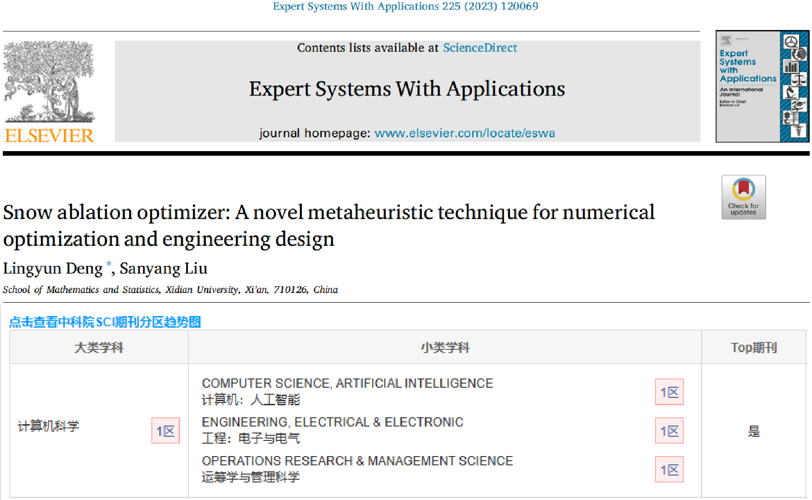
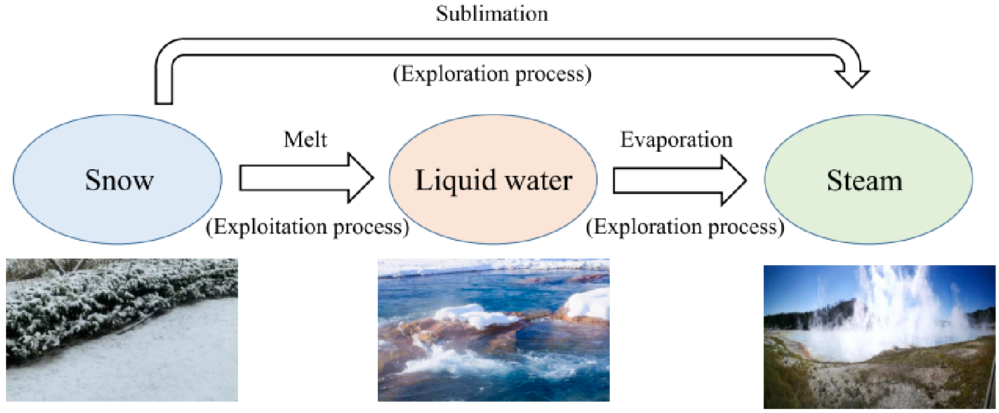
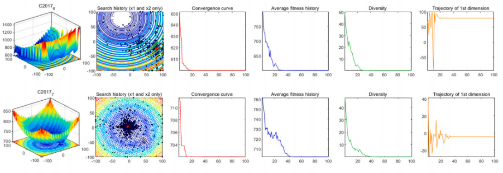
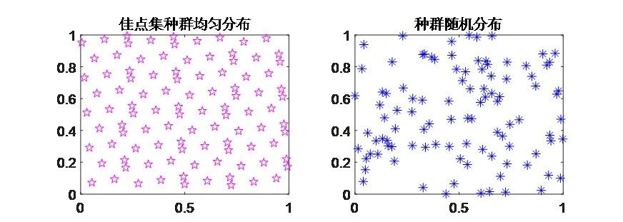
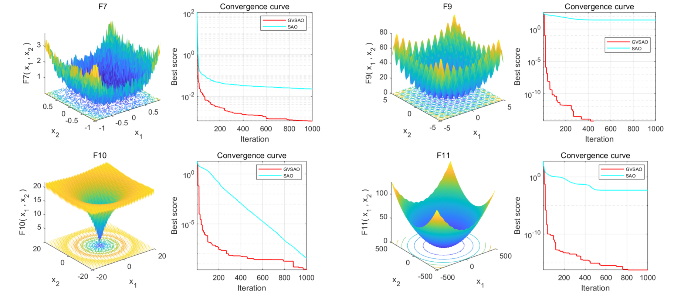
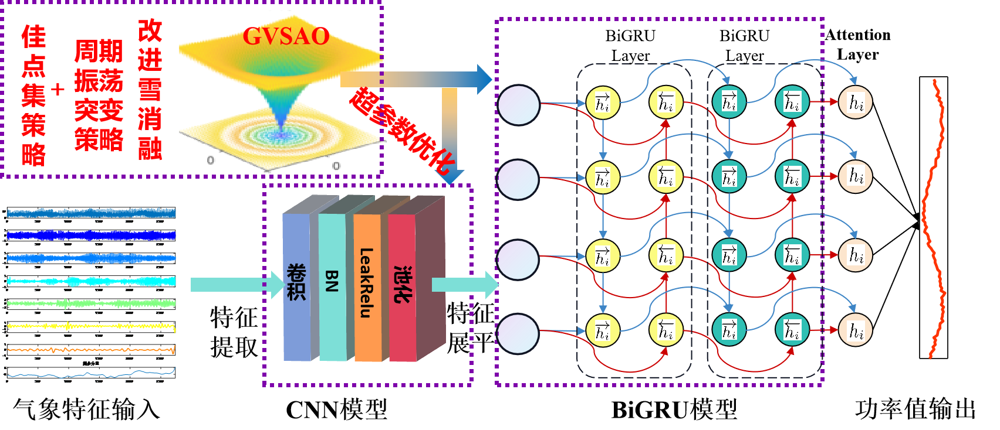
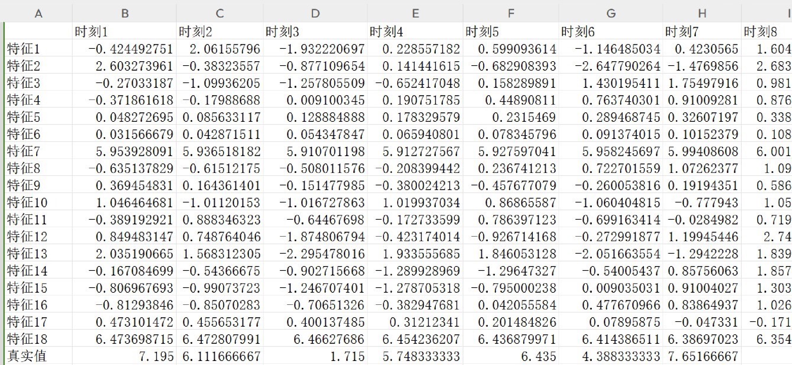
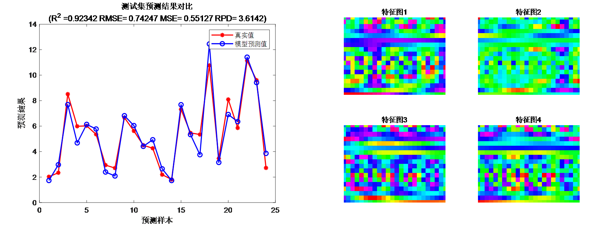
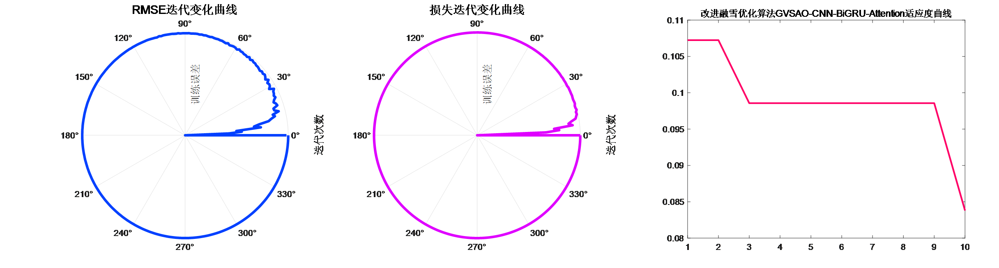
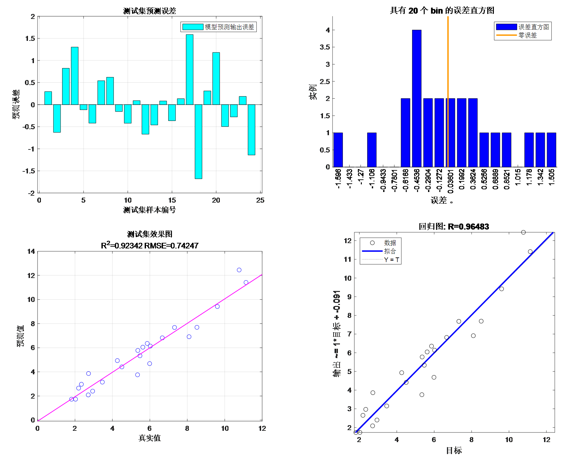
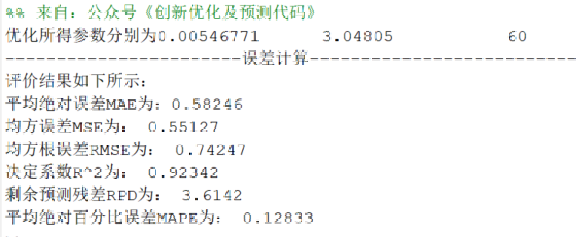

<!-- PAYMENT_BLOCK -->

## Get this dataset

- Payment link (Stripe): [Buy now](https://buy.stripe.com/3cs8yP7sY87d0vu9AB)
- Payment QR code: 

<!-- /PAYMENT_BLOCK -->
